# Mầm 🌱: xây thói quen tốt, bỏ thói quen xấu

Ứng dụng Flutter (Android + iOS) xoay quanh một mầm cây có cảm xúc:

- **Chăm thói quen tốt**: mỗi thói quen hoàn thành là một giọt nước tưới cho Mầm. Mầm lớn dần qua 6 cấp (Hạt giống → Ra hoa).
- **Cai thói quen xấu**: mỗi ngày "sạch" Mầm khỏe hơn và bạn tiết kiệm được tiền. Tái phạm thì Mầm héo, mặt mếu.
- **Nhắc nhở và thông báo**: Mầm và bạn đồng hành "Giọt" nhắc uống nước, nhắc thói quen, nhắc trước giờ hay thèm và chúc mừng mỗi cột mốc.

| Tưới Mầm | Thở cùng bình nước |
|---|---|
| 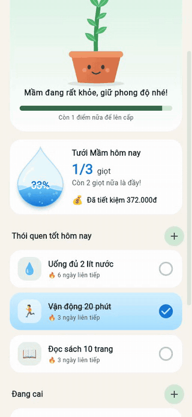 |  |

| Màn hình chính | Banner thành tích | Đang cai | Chế độ tối |
|---|---|---|---|
| 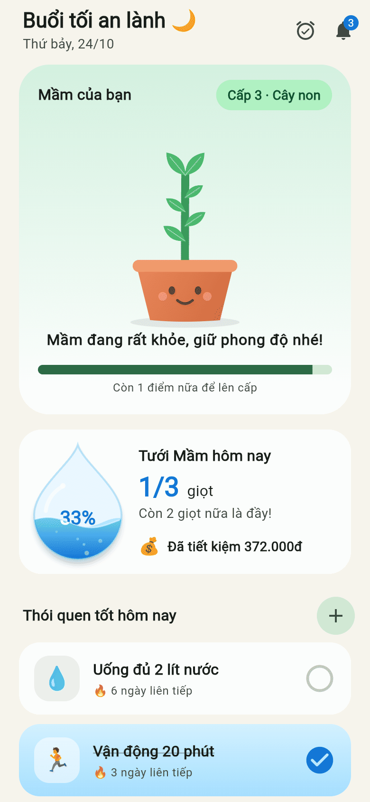 | 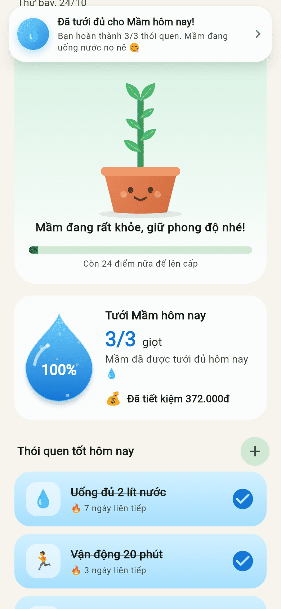 | 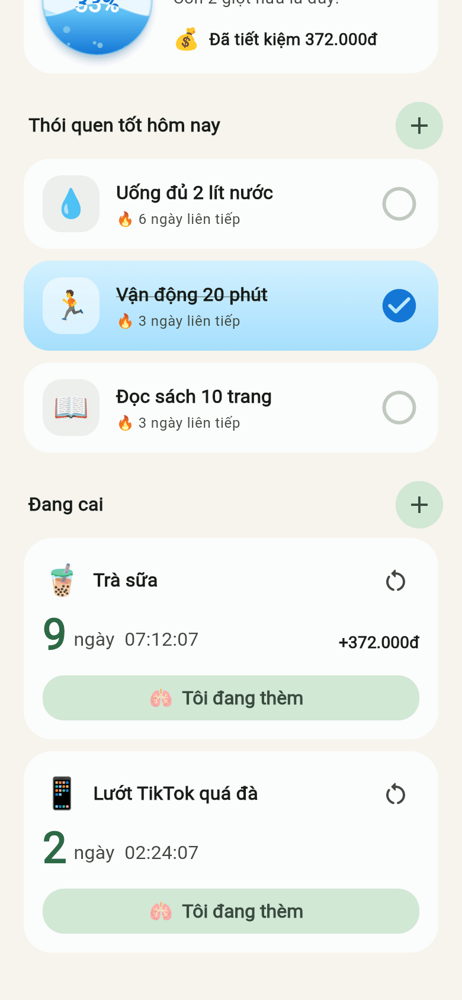 | 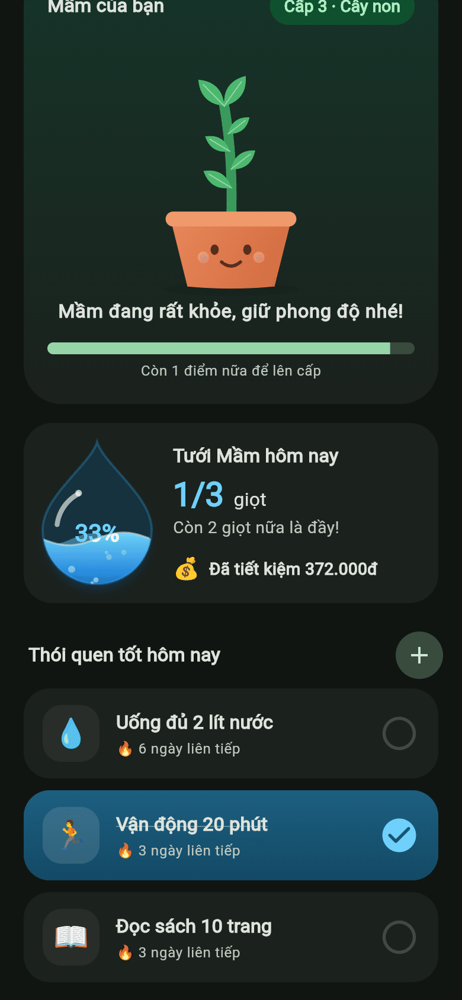 |

| Nhắc nhở | Nhắc uống nước | Giờ nhắc từng thói quen | Thông báo |
|---|---|---|---|
| 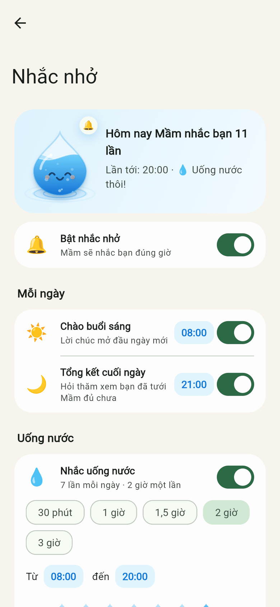 | 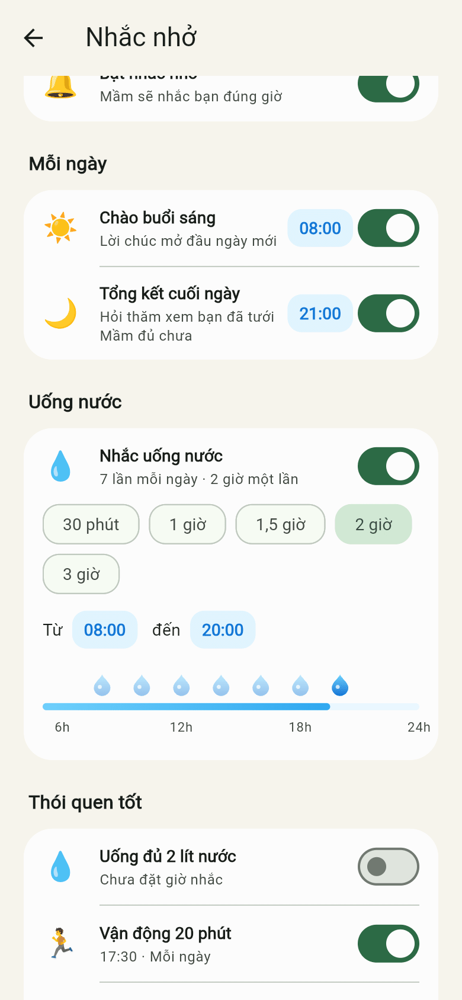 | 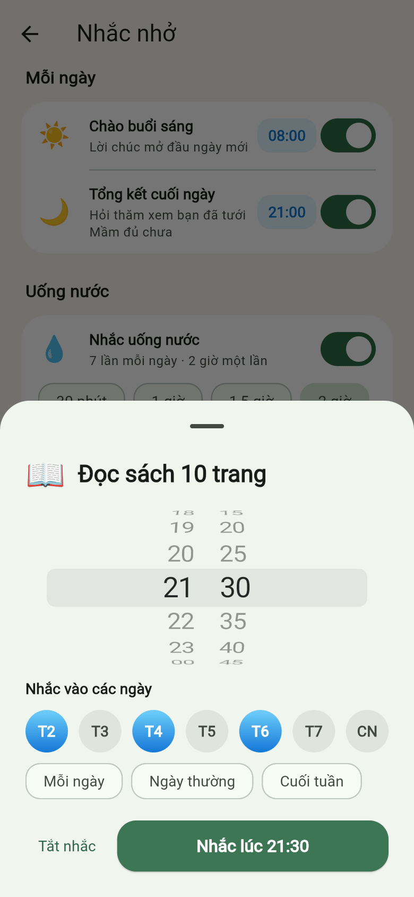 | 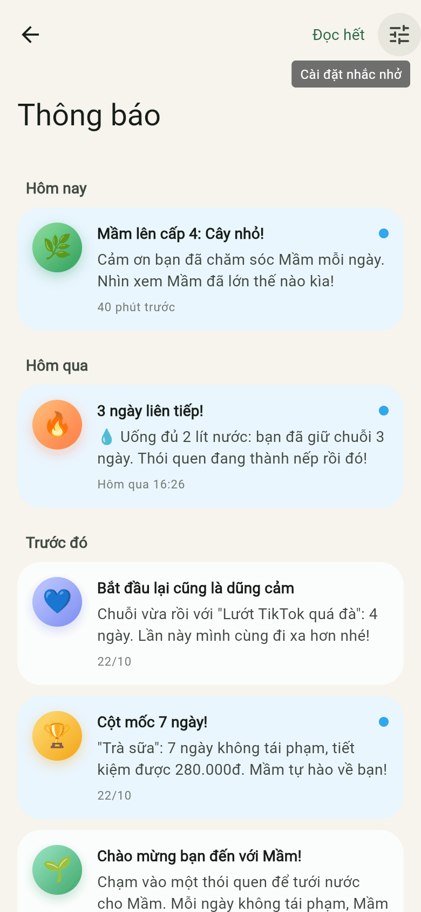 |

| Giới thiệu | Xin quyền thông báo | Bài thở khi thèm | Mầm héo |
|---|---|---|---|
| 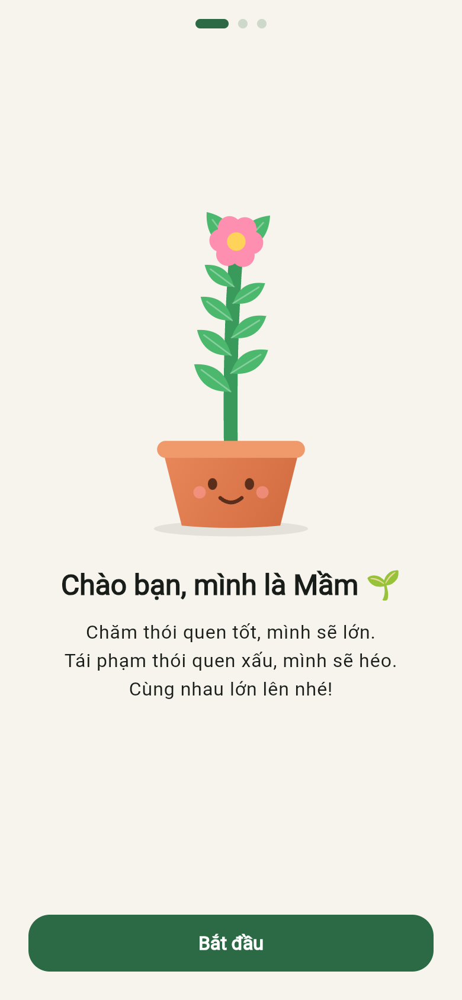 | 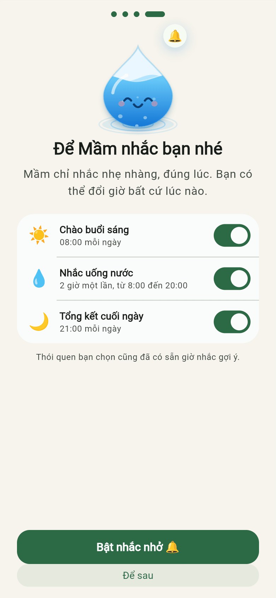 | 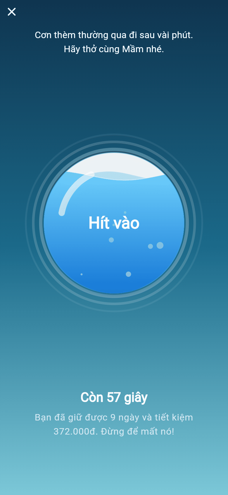 | 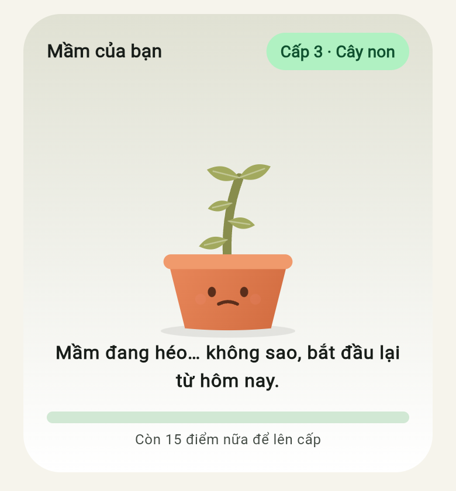 |

## Tính năng

**Thói quen**
- Onboarding 4 bước, chọn thói quen từ danh sách gợi ý gần gũi với người Việt (trà sữa, TikTok…), kèm giờ nhắc gợi ý cho từng thói quen.
- Chạm 1 lần để hoàn thành: nước dâng trong ô, một giọt nước bay vào chậu cây, cây nhún nhảy và cười tít mắt.
- Giọt nước "Tưới Mầm hôm nay" dâng theo tỉ lệ thói quen đã làm, sóng sánh kiểu lò xo. Đủ 100% thì bung chùm giọt nước ăn mừng.
- Bộ đếm thời gian "sạch" theo từng giây, kèm số tiền đã tiết kiệm.
- Nút **"Tôi đang thèm"** mở bài thở 60 giây: nước trong bình dâng khi hít vào, rút khi thở ra.
- Ghi nhận tái phạm với lời lẽ không phán xét, rồi bộ đếm bắt đầu lại.

**Nhắc nhở** (thông báo thật trên điện thoại qua `flutter_local_notifications`)
- Lời chào buổi sáng và tổng kết cuối ngày, chỉnh giờ bằng bánh xe chọn giờ.
- Nhắc uống nước theo chu kỳ (30 phút đến 3 giờ) trong khung giờ tuỳ chọn, có dòng thời gian giọt nước.
- Giờ nhắc riêng cho từng thói quen, chọn các thứ trong tuần (mỗi ngày, ngày thường, cuối tuần…).
- "Giờ hay thèm": nhắc trước khung giờ hay thèm thói quen xấu, chạm vào thông báo mở thẳng bài thở.
- Báo khi sắp đạt cột mốc 1, 3, 7, 14, 30… ngày không tái phạm.
- Xin quyền đúng lúc: giới thiệu lợi ích trước, chỉ hiện hộp thoại hệ thống khi người dùng bấm "Bật nhắc nhở". Bị chặn thì có nút mở Cài đặt.
- Giới hạn 60 lịch chờ (iOS chỉ giữ 64), ưu tiên lời chào và thói quen trước nhắc uống nước.

**Thông báo trong app**
- Banner trượt xuống khi đạt thành tích: lên cấp, chuỗi ngày liên tiếp, cột mốc không tái phạm, đã tưới đủ trong ngày. Mỗi thành tích chỉ báo một lần.
- Chuông có huy hiệu số chưa đọc, rung lên khi có thông báo mới.
- Hộp thông báo nhóm theo ngày, vuốt để xoá, "Đọc hết".

**Khác**
- Toàn bộ hiệu ứng vẽ bằng `CustomPainter` (không dùng ảnh), nên app nhẹ và chạy mượt.
- Lưu dữ liệu trên máy (`shared_preferences`), hỗ trợ dark mode, giao diện tiếng Việt.

## Cấu trúc

```
lib/
  main.dart                    # Khởi tạo app, dịch vụ thông báo, AppScope
  theme.dart                   # Theme Material 3
  models/                      # Thói quen, nhắc nhở, thông báo trong app
  state/app_state.dart         # Logic: điểm, cấp độ, cột mốc, hộp thông báo, lưu trữ
  services/
    reminder_planner.dart      # Lập lịch nhắc (thuần Dart, dễ test)
    notification_service.dart  # Thông báo thật (Android/iOS) và bản giả lập (web, test)
  widgets/
    liquid.dart                # Bình nước có sóng, bọt khí, chữ đổi màu theo mực nước
    droplet_fx.dart            # Giọt nước bay, bắn tung tóe, chùm giọt ăn mừng
    drop_buddy.dart            # Nhân vật "Giọt"
    sprout.dart                # Mầm cây vẽ tay
    in_app_banner.dart, ringing_bell.dart, time_sheet.dart, inbox_style.dart
  screens/                     # Onboarding, màn chính, nhắc nhở, thông báo, bài thở, thêm thói quen
  utils/format.dart            # Định dạng tiền, giờ, ngày tiếng Việt
test/                          # Unit test (lập lịch, cột mốc, lưu trữ) và widget test
```

## Chạy dự án

```bash
flutter pub get
flutter run          # chọn máy ảo Android / iOS simulator
flutter test
flutter analyze
```

Ghi chú nền tảng:
- **Android**: đã bật core library desugaring và khai báo receiver đặt lại lịch sau khi khởi động lại máy. Nhắc nhở dùng lịch không chính xác tuyệt đối (`inexactAllowWhileIdle`) nên không cần quyền báo thức chính xác.
- **iOS**: `AppDelegate` đặt `UNUserNotificationCenter` delegate để hiện thông báo cả khi app đang mở.
- **Web** chỉ để xem giao diện: trình duyệt không hỗ trợ đặt lịch thông báo nên dùng bản giả lập.

## Lộ trình tiếp theo

1. Widget màn hình chính (WidgetKit / Glance) để đánh dấu thói quen không cần mở app.
2. Màn thống kê (lịch nhiệt, biểu đồ tiền tiết kiệm).
3. Đồng bộ Apple Health / Health Connect.
4. Âm thanh nhẹ khi giọt nước rơi, nhân vật Rive với nhiều biểu cảm hơn.
5. Gói trả phí (để sau): theme và nhân vật mới, thống kê nâng cao.
