# Mầm 🌱: xây thói quen tốt, bỏ thói quen xấu


Ứng dụng Flutter (Android + iOS) xoay quanh một mầm cây có cảm xúc:

- **Chăm thói quen tốt**: mỗi thói quen hoàn thành là một giọt nước tưới cho Mầm. Uống nước là thói quen mặc định.
- **Mục tiêu mỗi ngày**: đạt mục tiêu thì Mầm tươi tốt, lỡ mục tiêu thì Mầm héo dần.
- **Cai thói quen xấu**: mỗi ngày "sạch" Mầm khỏe hơn. Tái phạm thì Mầm héo, mặt mếu.
- **Lịch, cảm xúc, thống kê, thời tiết**: lên lịch tập, ghi nhật ký cảm xúc, xem biểu đồ, và Mầm chào bạn kèm dự báo thời tiết.

| Tưới Mầm đến khi đạt mục tiêu | Icon động (lắc máy để nước sóng sánh) | Thở cùng bình nước |
|---|---|---|
|  | 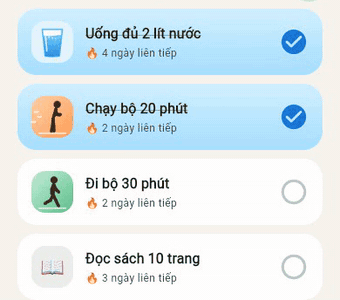 |  |

| Màn hình chính | Mầm buổi sáng | Mầm lúc mưa | Mầm hoàng hôn | Mầm ban đêm |
|---|---|---|---|---|
|  | 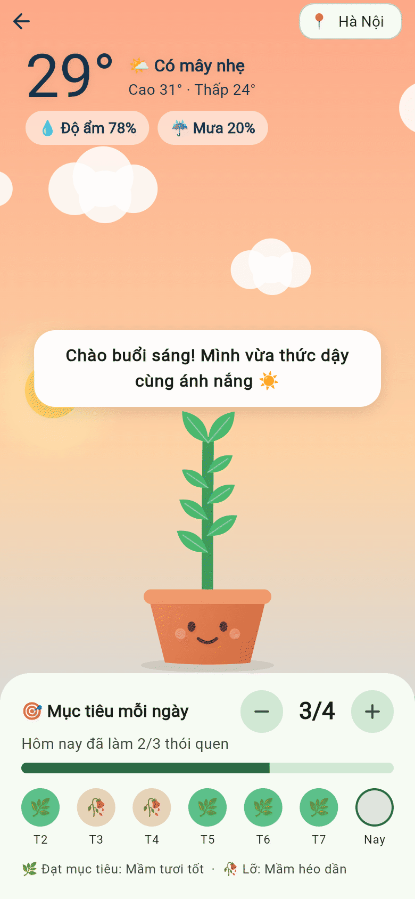 | 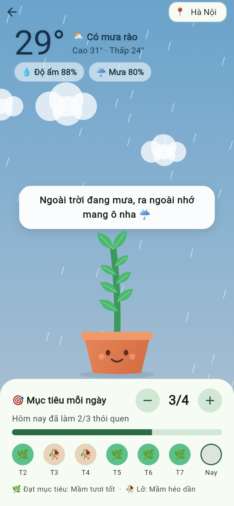 | 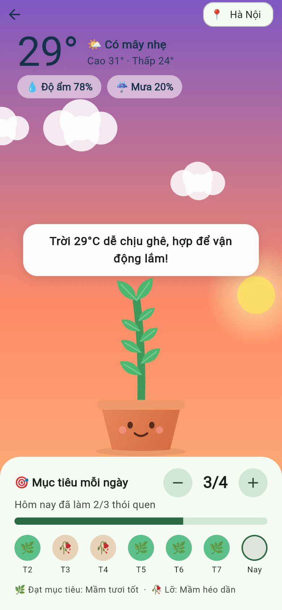 | 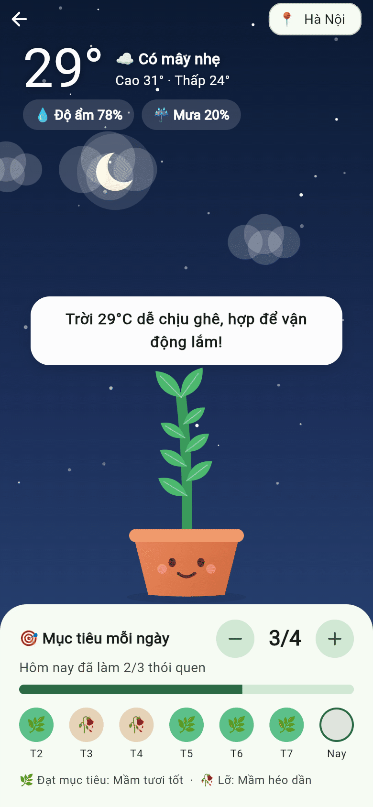 |

| Thống kê | Theo thói quen | Lịch | Thêm lịch | Cảm xúc |
|---|---|---|---|---|
| 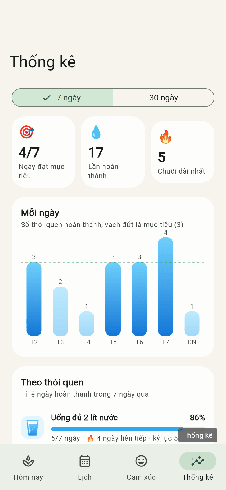 | 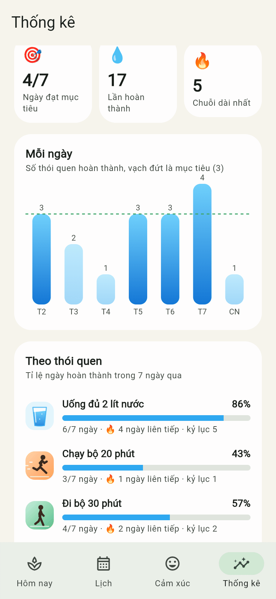 | 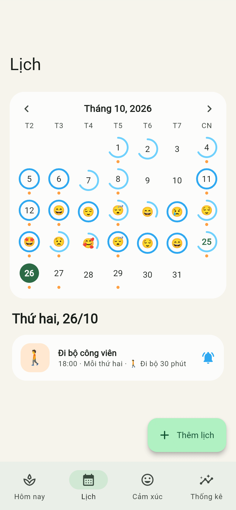 | 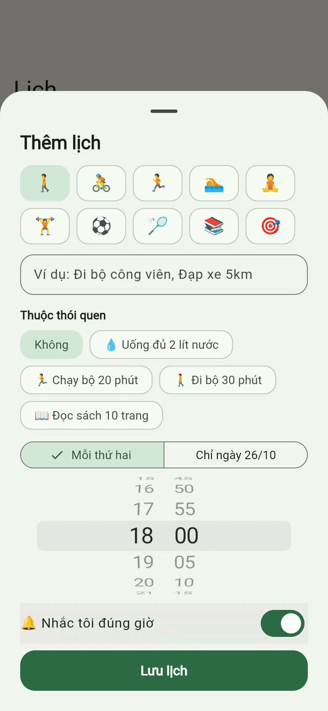 | 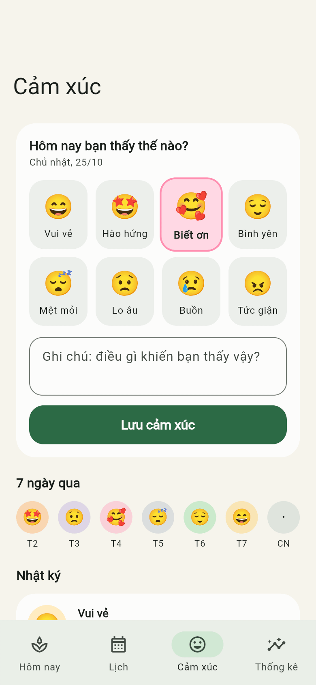 |

| Nhắc nhở | Nhắc lặp lại tuỳ chỉnh | Thông báo | Xin quyền thông báo | Mầm héo |
|---|---|---|---|---|
|  | 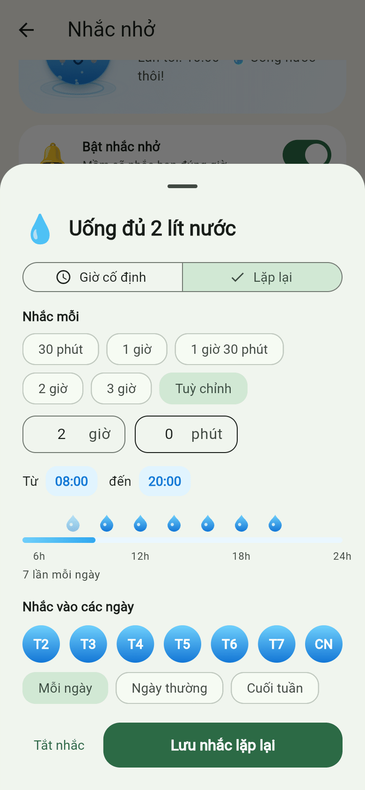 |  |  |  |

## Tính năng

**Thói quen và mục tiêu**
- Onboarding 4 bước; uống nước luôn được chọn sẵn, các thói quen khác có giờ nhắc gợi ý.
- Chạm 1 lần để hoàn thành: nước dâng trong ô, giọt nước bay vào chậu cây, cây nhún nhảy và cười tít mắt.
- Icon động cho từng thói quen: cốc nước có mặt nước luôn nằm ngang theo trọng lực và sóng sánh khi lắc máy (gia tốc kế), người chạy bộ, người đi bộ; thói quen khác là emoji "thở" nhẹ.
- Đặt mục tiêu mỗi ngày (ví dụ 3/4 thói quen). Giọt nước "Tưới Mầm hôm nay" dâng theo mục tiêu, đạt 100% thì bung chùm giọt nước ăn mừng.
- Sức sống của Mầm tính theo mức đạt mục tiêu 3 ngày gần nhất. Lỡ mục tiêu hôm qua thì Mầm báo "Hôm qua Mầm hơi khát".
- Âm thanh hiệu ứng (tự tổng hợp): giọt nước khi hoàn thành, chuông vui khi đạt mục tiêu, nốt trầm khi lỡ mục tiêu. Tắt được trong Nhắc nhở.

**Mầm và thời tiết** (chạm vào cây mầm)
- Bầu trời theo giờ: bình minh, ban ngày, hoàng hôn, đêm sao; mặt trời và mặt trăng chạy theo cung, mây trôi, mưa rơi khi trời mưa.
- Nhiệt độ, độ ẩm, cao/thấp và khả năng mưa từ Open-Meteo (miễn phí, không cần khoá), chọn trong 10 thành phố.
- Lời chào thay đổi theo giờ, thời tiết, mục tiêu; chạm vào cây để nghe câu khác.
- Đặt mục tiêu ngày và xem 7 ngày đạt/lỡ.

**Lịch, cảm xúc, thống kê**
- Lịch tháng: vòng tiến độ mục tiêu từng ngày, emoji cảm xúc, chấm sự kiện. Thêm lịch một lần hoặc lặp hằng tuần, gắn với thói quen (ví dụ "Tập thể dục": thứ hai đi bộ, thứ ba đạp xe), có nhắc đúng giờ.
- Nhật ký cảm xúc: 8 cảm xúc chủ đạo, ghi chú, 7 ngày qua và lịch sử.
- Thống kê 7/30 ngày: biểu đồ cột có vạch mục tiêu, tỉ lệ từng thói quen kèm chuỗi và kỷ lục, biểu đồ cảm xúc, số ngày "sạch".

**Nhắc nhở** (thông báo thật trên điện thoại qua `flutter_local_notifications`)
- Mỗi thói quen chọn **giờ cố định** hoặc **lặp lại theo chu kỳ** (30 phút đến 3 giờ, hoặc tự nhập giờ/phút) trong khung giờ tuỳ chọn, theo các thứ trong tuần.
- Lời chào buổi sáng kèm dự báo thời tiết trong ngày, tổng kết cuối ngày, nhắc lịch tập.
- "Giờ hay thèm": nhắc trước khung giờ hay thèm thói quen xấu, chạm vào thông báo mở thẳng bài thở.
- Báo khi sắp đạt cột mốc 1, 3, 7, 14, 30… ngày không tái phạm.
- Xin quyền đúng lúc, có nút mở Cài đặt khi bị chặn; giới hạn 60 lịch chờ (iOS chỉ giữ 64).

**Thông báo trong app**
- Banner khi đạt thành tích: lên cấp, chuỗi ngày, cột mốc, đạt hoặc lỡ mục tiêu. Mỗi thành tích chỉ báo một lần.
- Chuông có huy hiệu số chưa đọc; hộp thông báo nhóm theo ngày, vuốt để xoá.

**Khác**
- Icon app hình cây mầm (Android có icon thích ứng và icon thông báo đơn sắc).
- Hiệu ứng vẽ bằng `CustomPainter`, không dùng ảnh. Lưu dữ liệu trên máy, hỗ trợ dark mode, giao diện tiếng Việt.

## Cấu trúc

```
lib/
  main.dart                    # Khởi tạo app, dịch vụ thông báo/thời tiết/âm thanh
  models/                      # Thói quen, nhắc nhở, lịch và cảm xúc, thông báo trong app
  state/app_state.dart         # Logic: mục tiêu, điểm, cột mốc, lịch, cảm xúc, thời tiết, lưu trữ
  services/
    reminder_planner.dart      # Lập lịch nhắc (thuần Dart, dễ test)
    notification_service.dart  # Thông báo thật (Android/iOS) và bản giả lập (web, test)
    weather.dart               # Open-Meteo, mô tả thời tiết tiếng Việt
    sound_service.dart         # Âm thanh hiệu ứng
  widgets/
    liquid.dart, droplet_fx.dart, drop_buddy.dart   # Hiệu ứng nước và nhân vật "Giọt"
    habit_icon.dart            # Icon động: cốc nước theo gia tốc kế, người chạy, người đi bộ
    sky_scene.dart, sprout.dart                     # Bầu trời theo giờ và mầm cây
  screens/                     # Hôm nay, Lịch, Cảm xúc, Thống kê, Mầm, Nhắc nhở, Thông báo…
assets/sounds/                 # drop.wav, success.wav, missed.wav
assets/icon/                   # Ảnh gốc icon app (chạy `dart run flutter_launcher_icons` sau khi sửa)
test/                          # Unit test và widget test
```

## Chạy dự án

```bash
flutter pub get
flutter run          # chọn máy ảo Android / iOS simulator
flutter test
flutter analyze
```

Ghi chú nền tảng:
- **Android**: đã bật core library desugaring và khai báo receiver đặt lại lịch sau khi khởi động lại máy. Nhắc nhở dùng lịch không chính xác tuyệt đối (`inexactAllowWhileIdle`) nên không cần quyền báo thức chính xác.
- **iOS**: `AppDelegate` đặt `UNUserNotificationCenter` delegate để hiện thông báo cả khi app đang mở.
- **Web** chỉ để xem giao diện: trình duyệt không hỗ trợ đặt lịch thông báo nên dùng bản giả lập.
- Lời chào buổi sáng là thông báo lặp hằng ngày nên nội dung dự báo được cập nhật mỗi lần mở app (khi có mạng).

## Build APK tự động (GitHub Actions)

Workflow `.github/workflows/build-apk.yml` chạy `analyze`, `test` rồi build APK tên `bad-habit-<version>.apk`:

- **Push lên `dev`/`main`, pull request, hoặc bấm "Run workflow"** trong tab Actions: version lấy từ dòng `version:` trong `pubspec.yaml`. Tải APK ở mục **Artifacts** của lần chạy.
- **Đẩy tag** `v1.2.0`: version lấy từ tag (`bad-habit-1.2.0.apk`), APK được đính kèm vào **GitHub Release**.

  ```bash
  git tag v1.0.0 && git push origin v1.0.0
  ```

Mỗi lần build có số build tăng dần (`github.run_number`), nên bản mới cài đè được bản cũ, **với điều kiện cùng khóa ký**. Nếu không cấu hình khóa, APK được ký bằng khóa debug ngẫu nhiên của máy CI, và mỗi lần cài bản mới phải gỡ bản cũ trước. Để có khóa cố định:

1. Tạo keystore một lần (giữ kỹ file và mật khẩu, mất là không cập nhật app được nữa):
   ```bash
   keytool -genkey -v -keystore upload-keystore.jks -keyalg RSA -keysize 2048 -validity 10000 -alias upload
   base64 -w0 upload-keystore.jks   # macOS: base64 -i upload-keystore.jks
   ```
2. Vào **Settings › Secrets and variables › Actions** của repo, thêm 4 secret:
   `ANDROID_KEYSTORE_BASE64` (chuỗi base64 ở trên), `ANDROID_KEYSTORE_PASSWORD`, `ANDROID_KEY_ALIAS` (`upload`), `ANDROID_KEY_PASSWORD`.

## Lộ trình tiếp theo

1. Widget màn hình chính (WidgetKit / Glance) để đánh dấu thói quen không cần mở app.
2. Lấy vị trí bằng GPS thay vì chọn thành phố.
3. Đồng bộ Apple Health / Health Connect (số bước cho đi bộ, chạy bộ).
4. Gói trả phí (để sau): theme và nhân vật mới, thống kê nâng cao.
